Hi! I'm Renato, a Bioinformatician specialising in omics approaches to understanding disease, particularly for neurodegenerative disorders.

I'm currently a DRIVE-Health CDT PhD Student and a Research Assistant at King's College London, investigating the gut-brain axis in motor neuron disorders through statistical and machine learning approaches.

Feel free to explore my work or reach out if you wish to connect!

---

### 📊 GitHub Stats

<!-- cool-readme:start -->
<!-- Cards by github-cool-readme: https://github.com/pedrocatalao/github-cool-readme -->

<picture>
  <source media="(prefers-color-scheme: dark)" srcset="https://raw.githubusercontent.com/renatosantos98/renatosantos98/cards/summary-dark.svg">
  
</picture>
<picture>
  <source media="(prefers-color-scheme: dark)" srcset="https://raw.githubusercontent.com/renatosantos98/renatosantos98/cards/languages-dark.svg">
  
</picture>

<picture>
  <source media="(prefers-color-scheme: dark)" srcset="https://raw.githubusercontent.com/renatosantos98/renatosantos98/cards/contributions-dark.svg">
  
</picture>
<picture>
  <source media="(prefers-color-scheme: dark)" srcset="https://raw.githubusercontent.com/renatosantos98/renatosantos98/cards/weekly-dark.svg">
  
</picture>

<picture>
  <source media="(prefers-color-scheme: dark)" srcset="https://raw.githubusercontent.com/renatosantos98/renatosantos98/cards/streaks-dark.svg">
  
</picture>
<picture>
  <source media="(prefers-color-scheme: dark)" srcset="https://raw.githubusercontent.com/renatosantos98/renatosantos98/cards/repos-dark.svg">
  
</picture>

<!-- cool-readme:end -->
